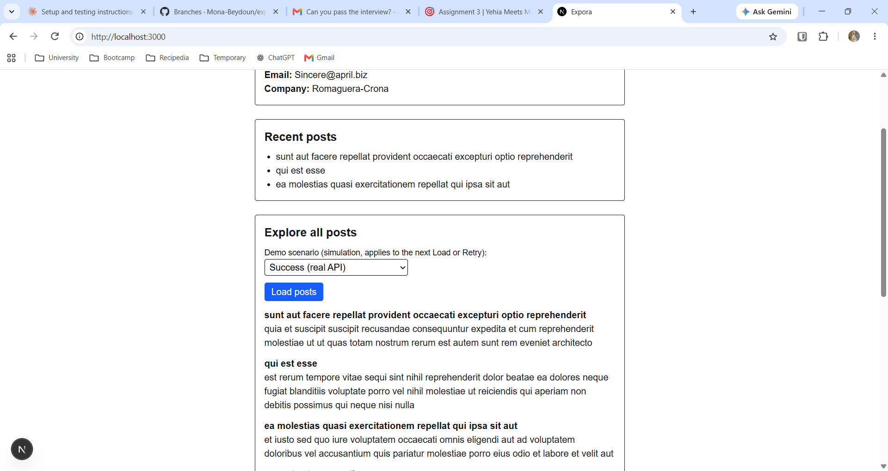
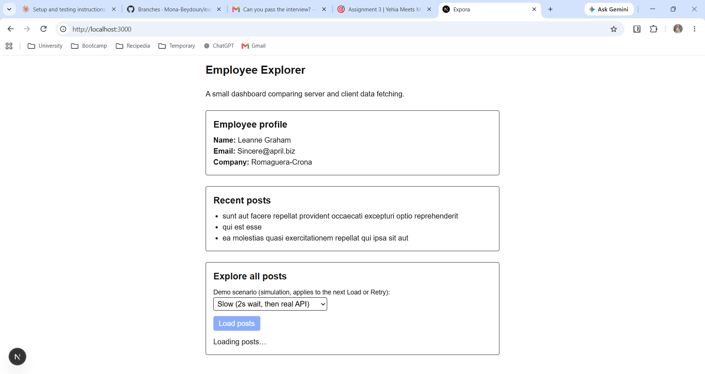
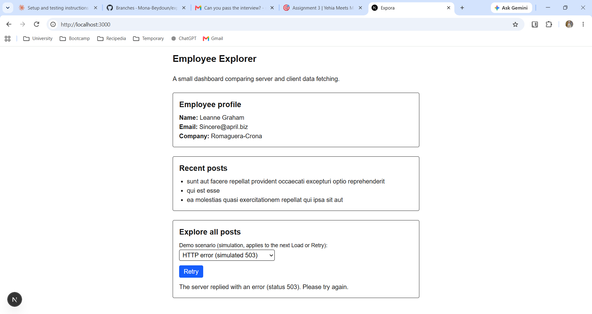
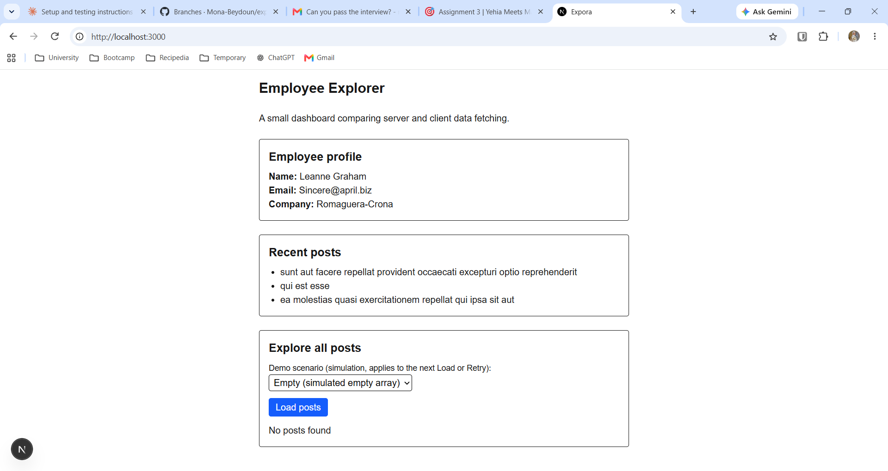

# Testing Evidence

**Project:** Expora (Employee Explorer)
**Next.js version:** [FILL IN: output of `npm ls next`]
**Browser:** [FILL IN: e.g. Chrome]
**How I tested:** ran `npm run dev`, did a direct reload (F5) of http://localhost:3000, and kept the DevTools Network tab open.

| # | Check | Expected | Actual | Pass/Fail |
|---|---|---|---|---|
| 1 | Server profile | Name, email, and company of employee 1 (Leanne Graham, Sincere@april.biz, Romaguera-Crona) | The profile section showed the employee 1 data. No request to jsonplaceholder appeared in the browser Network tab, because the request runs on the server. | Pass |
| 2 | Server preview | Fallback shows during the 2s delay while the title and other sections stay visible | After F5, the title and intro appeared immediately. "Loading recent posts…" showed in the preview area for about 2 seconds, then three post titles replaced it. | Pass |
| 3 | Client idle | No client posts request before the first click | With Network filtered by jsonplaceholder, nothing appeared until I clicked Load posts. | Pass |
| 4 | Client slow | Loading feedback appears and repeat clicks cannot start duplicate requests | With Slow selected, "Loading posts…" appeared and the button was disabled while loading. [FILL IN: confirm only one request appeared in Network] | Pass |
| 5 | Client success | Post titles and bodies appear | Titles and bodies appeared. A request to `jsonplaceholder.typicode.com/posts?userId=1` showed in the Network tab, which confirms it runs in the browser. | Pass |
| 6 | HTTP failure | Simulated 503 goes through `parseResponse`, creates an `ApiError`, and shows a message with Retry | The error message with the status 503 and a Retry button appeared. No network request appeared, because the 503 is created locally with `new Response(...)`. | Pass |
| 7 | Empty response | "No posts found" appears and no error message | "No posts found" appeared with no error message. | Pass |
| 8 | Recovery | After an HTTP error, switching to Success and clicking Retry shows posts and clears the error | Clicking Retry while HTTP error was still selected showed the error again, because the same simulated 503 is repeated. After switching to Success and clicking Retry, the posts appeared and the error cleared. | Pass |
| 9 | Section independence | A failed client request does not remove the profile or server preview | After the client error, the profile and recent posts sections were still visible. | Pass |
| 10 | Usability | Labelled controls, visible keyboard focus, readable at around 360px | [FILL IN: Tab through the select and button. Did you see a focus outline? Did the page fit at 360px with no sideways scroll?] | [FILL IN] |

## Steps used for timing checks
I pressed F5 on http://localhost:3000 and watched the Recent posts area. The fallback text appeared for about 2 seconds while the title, intro, and profile stayed visible. I used a direct reload because navigation and prefetching can change what is observed.

## Commands
- `npm run lint`: [FILL IN: paste the real result. Initially it reported `react-hooks/error-boundaries` errors because I built JSX inside `try`. I fixed this by keeping only the `await` inside `try/catch`.]
- `npm run build`: [FILL IN: paste the real result, e.g. "Compiled successfully" or the error]

## Screenshots
- Normal state: 
- Server preview loading: 
- Client error: 
- Empty state: 

## Notes
- The HTTP error and Empty scenarios are local simulations created with `new Response(...)`. They are not real JSONPlaceholder responses.
- The Slow and Success scenarios use the real JSONPlaceholder API.
- The 2-second delay in the server preview is an intentional learning simulation.

## Not tested / limitations
- [FILL IN: anything you did not test, e.g. real network failure, other browsers, production deployment]
